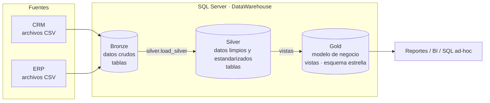

# Data Warehouse con SQL Server (Arquitectura Medallion)

Práctica **P8 – Data Warehouse from Scratch** (Minería de Datos). Réplica, paso a paso, del proyecto
del video *"SQL Data Warehouse from Scratch"* de **Data with Baraa**.

**Equipo**
- Isaac Pancardo Botello
- Carlos Emiliano Mendoza Hernandez
- Alan Magno Martinez Muñoz

---

## Arquitectura

Se sigue la arquitectura **Medallion** (Bronze → Silver → Gold):



| Capa   | Objeto  | Carga                                   | Transformaciones                                    |
|--------|---------|-----------------------------------------|-----------------------------------------------------|
| Bronze | Tablas  | Batch, full load (TRUNCATE + BULK INSERT) | Ninguna (datos tal cual vienen de la fuente)       |
| Silver | Tablas  | Batch, full load (TRUNCATE + INSERT)      | Limpieza, estandarización, normalización, columnas derivadas, enriquecimiento |
| Gold   | Vistas  | Sin carga (vistas)                        | Integración, agregaciones, lógica de negocio, esquema estrella |

## Estructura del repositorio

```
data-warehouse-mineria-datos/
├── datasets/                 # Datos fuente (CRM y ERP) en CSV
│   ├── source_crm/
│   └── source_erp/
├── docs/                     # Documentación del proyecto
│   ├── data_architecture.md  # Arquitectura y flujo de datos
│   ├── data_catalog.md       # Catálogo de datos de la capa Gold
│   ├── data_model.md         # Modelo estrella
│   ├── naming_conventions.md # Convenciones de nombres
│   └── cuestionario_respuestas.pdf
├── scripts/
│   ├── run_all.sql           # Instalación nueva en modo SQLCMD
│   ├── reload.sql            # Recarga sin recrear la base
│   ├── verify_pipeline.py    # Ejecución aislada y evidencia
│   ├── prepare_sources.py    # Copias CSV sin pérdida del último registro
│   ├── init_database.sql     # Crea la base DataWarehouse y los esquemas
│   ├── bronze/               # DDL y procedimiento de carga de Bronze
│   ├── silver/               # DDL y procedimiento de carga de Silver
│   └── gold/                 # Vistas de Gold
├── tests/                    # Contratos CSV, aserciones y pruebas de recuperación
├── LICENSE
└── README.md
```

## Ejecución y verificación reproducible

Requisitos: **Docker Desktop/Engine activo y Python 3.10+**. Desde la raíz del repositorio:

```bash
python3 scripts/verify_pipeline.py
```

El verificador valida los seis CSV contra `tests/source_manifest.json`, prepara copias
con terminador de registro final sin modificar las fuentes, crea una instancia
**aislada** de SQL Server 2022 Developer con imagen fijada por digest, ejecuta las etapas,
comprueba calidad, recarga y recuperación ante errores, y retira su contenedor al terminar.
No publica puertos ni utiliza bases de datos existentes. La contraseña temporal no se guarda
en el repositorio. El contenedor acepta la licencia de SQL Server Developer (`ACCEPT_EULA=Y`).
En Apple Silicon utiliza emulación `linux/amd64`; la descarga inicial requiere varios GB.

Los resultados reales se escriben en [`docs/evidence/latest/`](docs/evidence/latest/).
El código de salida es **0 solo si pasan todas las verificaciones**; `summary.json` conserva
los códigos de salida, la versión utilizada, las huellas de los archivos y el estado final.
Para conservar otra corrida: `python3 scripts/verify_pipeline.py --output /ruta/a/evidencia`.

### SQL Server instalado / SSMS (Windows)

1. Instalar SQL Server y `sqlcmd`, o activar **Query → SQLCMD Mode** en SSMS.
2. Preparar las copias de carga (el script valida los originales y agrega únicamente el CRLF
   final que falta en algunos archivos):

   ```powershell
   python scripts/prepare_sources.py --output "C:\sql\dwh_project\datasets"
   ```

   Si SQL Server está en otra máquina, copiar allí esta carpeta preparada. El proceso de
   SQL Server debe poder leerla; no basta que exista en el cliente. No omitir este paso:
   la prueba real detectó registros finales omitidos al cargar los CSV sin terminador.
3. Desde la raíz del repositorio, ejecutar (configurar la autenticación del entorno):

```powershell
sqlcmd -S localhost -E -b -i scripts/run_all.sql -v DataRoot="C:\sql\dwh_project\datasets"
```

`run_all.sql` instala Bronze, carga y verifica los CSV, instala/carga Silver, crea Gold y
aplica las aserciones de aceptación. Incluye los separadores `GO` necesarios.
Se detiene si `DataWarehouse` ya existe. Para repetir la carga de una instalación existente:

```powershell
sqlcmd -S localhost -E -b -i scripts/reload.sql -v DataRoot="C:\sql\dwh_project\datasets"
```

En SSMS, las rutas `:r` deben resolverse desde la raíz del repositorio y se debe definir
`DataRoot` mediante `:setvar DataRoot "C:\sql\dwh_project\datasets"` antes del script.
El script original `init_database.sql` conserva su comportamiento destructivo del tutorial;
la entrada recomendada `run_all.sql` lo protege rechazando una base existente.

### Evidencia del trabajo por etapas

- [Bitácora y checklist de replicación](docs/replication_steps.md).
- [Análisis de fuentes, contratos y criterios de validación](docs/source_analysis.md).
- [Resultados de la última ejecución](docs/evidence/latest/summary.json).
- [Arquitectura y flujo](docs/data_architecture.md), [modelo estrella](docs/data_model.md)
  y [catálogo](docs/data_catalog.md).

La evidencia acredita la ejecución documentada; los commits históricos no se presentan como
prueba de haber seguido el video en tiempo real. El cuestionario PDF responde al **código del
video**; las mejoras locales de manejo de errores están explicadas en la bitácora.

## Requerimientos (del video)

- **Objetivo:** construir un data warehouse moderno en SQL Server que consolide los datos de ventas para reportes analíticos.
- **Fuentes:** dos sistemas (ERP y CRM) en archivos CSV.
- **Calidad:** limpiar y resolver problemas de calidad antes del análisis.
- **Integración:** unir ambas fuentes en un modelo amigable para consultas analíticas.
- **Alcance:** solo el dato más reciente; no se requiere historización.
- **Documentación:** documentar el modelo para usuarios de negocio y equipos de analítica.

## Créditos

Las respuestas del cuestionario de la práctica están en [`docs/cuestionario_respuestas.pdf`](docs/cuestionario_respuestas.pdf).

Proyecto basado en *SQL Data Warehouse from Scratch* de Baraa Khatib Salkini (Data with Baraa),
[repositorio original](https://github.com/DataWithBaraa/sql-data-warehouse-project) bajo licencia MIT.
Los datasets provienen de ese repositorio.
