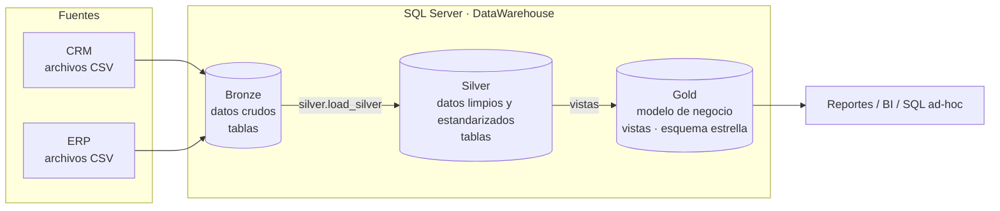

# Data Warehouse con SQL Server (Arquitectura Medallion)

Práctica **P8 – Data Warehouse from Scratch** (Minería de Datos). Réplica, paso a paso, del proyecto
del video *"SQL Data Warehouse from Scratch"* de **Data with Baraa**.

**Equipo**
- Isaac Pancardo Botello
- Carlos Emiliano Mendoza Hernandez
- Alan Magno Martinez Muñoz

---

## Arquitectura

Se sigue la arquitectura **Medallion** (Bronze → Silver → Gold):



| Capa   | Objeto  | Carga                                   | Transformaciones                                    |
|--------|---------|-----------------------------------------|-----------------------------------------------------|
| Bronze | Tablas  | Batch, full load (TRUNCATE + BULK INSERT) | Ninguna (datos tal cual vienen de la fuente)       |
| Silver | Tablas  | Batch, full load (TRUNCATE + INSERT)      | Limpieza, estandarización, normalización, columnas derivadas, enriquecimiento |
| Gold   | Vistas  | Sin carga (vistas)                        | Integración, agregaciones, lógica de negocio, esquema estrella |

## Estructura del repositorio

```
data-warehouse-mineria-datos/
├── datasets/                 # Datos fuente (CRM y ERP) en CSV
│   ├── source_crm/
│   └── source_erp/
├── docs/                     # Documentación del proyecto
│   ├── data_architecture.md  # Arquitectura y flujo de datos
│   ├── data_catalog.md       # Catálogo de datos de la capa Gold
│   ├── data_model.md         # Modelo estrella
│   ├── naming_conventions.md # Convenciones de nombres
│   └── cuestionario_respuestas.pdf
├── scripts/
│   ├── init_database.sql     # Crea la base DataWarehouse y los esquemas
│   ├── bronze/               # DDL y procedimiento de carga de Bronze
│   ├── silver/               # DDL y procedimiento de carga de Silver
│   └── gold/                 # Vistas de Gold
├── tests/                    # Pruebas de calidad de datos
├── LICENSE
└── README.md
```

## Cómo ejecutarlo

1. Instalar SQL Server (Express/Developer) y SSMS.
2. Copiar la carpeta `datasets/` a `C:\sql\dwh_project\datasets\` (o ajustar las rutas en `scripts/bronze/proc_load_bronze.sql`).
3. Ejecutar en orden:
   ```sql
   -- 1. Base de datos y esquemas
   :r scripts/init_database.sql
   -- 2. Bronze
   :r scripts/bronze/ddl_bronze.sql
   :r scripts/bronze/proc_load_bronze.sql
   EXEC bronze.load_bronze;
   -- 3. Silver
   :r scripts/silver/ddl_silver.sql
   :r scripts/silver/proc_load_silver.sql
   EXEC silver.load_silver;
   -- 4. Gold
   :r scripts/gold/ddl_gold.sql
   ```
4. Validar con `tests/quality_checks_silver.sql` y `tests/quality_checks_gold.sql`.

## Requerimientos (del video)

- **Objetivo:** construir un data warehouse moderno en SQL Server que consolide los datos de ventas para reportes analíticos.
- **Fuentes:** dos sistemas (ERP y CRM) en archivos CSV.
- **Calidad:** limpiar y resolver problemas de calidad antes del análisis.
- **Integración:** unir ambas fuentes en un modelo amigable para consultas analíticas.
- **Alcance:** solo el dato más reciente; no se requiere historización.
- **Documentación:** documentar el modelo para usuarios de negocio y equipos de analítica.

## Créditos

Las respuestas del cuestionario de la práctica están en [`docs/cuestionario_respuestas.pdf`](docs/cuestionario_respuestas.pdf).

Proyecto basado en *SQL Data Warehouse from Scratch* de Baraa Khatib Salkini (Data with Baraa),
[repositorio original](https://github.com/DataWithBaraa/sql-data-warehouse-project) bajo licencia MIT.
Los datasets provienen de ese repositorio.
