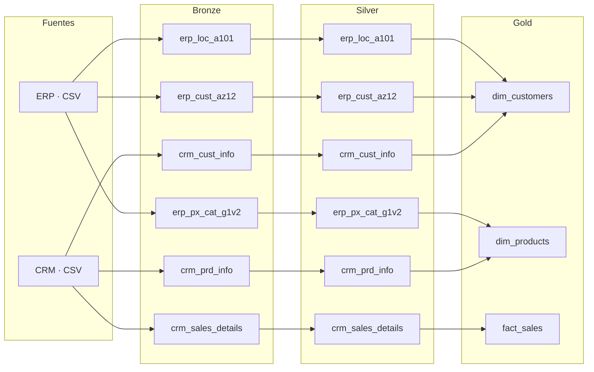
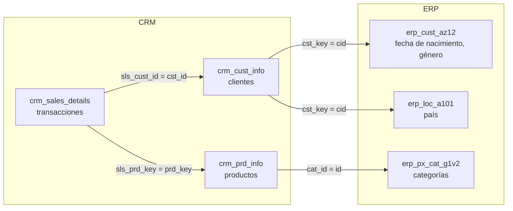

# Arquitectura de datos

## Capas (Medallion)

| | Bronze | Silver | Gold |
|---|---|---|---|
| **Definición** | Datos crudos, sin cambios | Datos limpios y estandarizados | Datos listos para el negocio |
| **Objetivo** | Trazabilidad y depuración | Preparar datos para análisis | Consumo en reportes y analítica |
| **Tipo de objeto** | Tablas | Tablas | Vistas |
| **Método de carga** | Full load (TRUNCATE + BULK INSERT) | Full load (TRUNCATE + INSERT) | Ninguno |
| **Transformación** | Ninguna | Limpieza, estandarización, normalización, columnas derivadas, enriquecimiento | Integración, agregación, lógica de negocio |
| **Modelado** | Ninguno (as-is) | Ninguno (as-is) | Esquema estrella |
| **Usuarios** | Ingenieros de datos | Ingenieros y analistas de datos | Analistas y usuarios de negocio |

## Integración de datos

