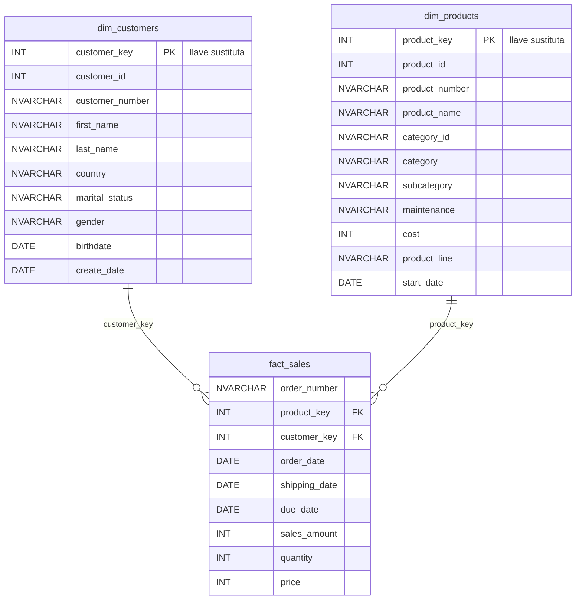

# Modelo de datos (capa Gold) – Esquema estrella

- Regla de negocio: `sales_amount = quantity * price`.
- Las dimensiones están desnormalizadas (estrella, no copo de nieve): `dim_customers` integra CRM + ERP (AZ12, LOC_A101) y `dim_products` integra el producto con su categoría (PX_CAT_G1V2).
- Las llaves sustitutas se generan con `ROW_NUMBER()` dentro de las vistas.
