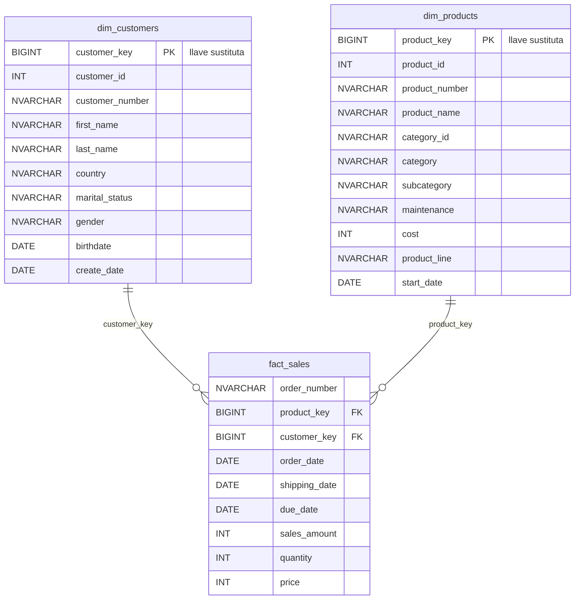

# Modelo de datos (capa Gold) – Esquema estrella

- Regla de negocio: `sales_amount = quantity * price`.
- Las dimensiones están desnormalizadas (estrella, no copo de nieve): `dim_customers` integra CRM + ERP (AZ12, LOC_A101) y `dim_products` integra el producto con su categoría (PX_CAT_G1V2).
- Las llaves sustitutas se generan con `ROW_NUMBER()` dentro de las vistas.

- **Grano del hecho:** una línea de producto de una orden de venta de la fuente; `order_number`
  por sí solo no es llave única.
- Las marcas PK/FK del diagrama son relaciones lógicas: las vistas no crean restricciones
  físicas de llave primaria o foránea. La integridad se verifica con aserciones SQL.
- `ROW_NUMBER()` devuelve `BIGINT`. Las llaves se calculan al consultar las vistas y no son
  identificadores persistentes entre versiones distintas del dataset.
